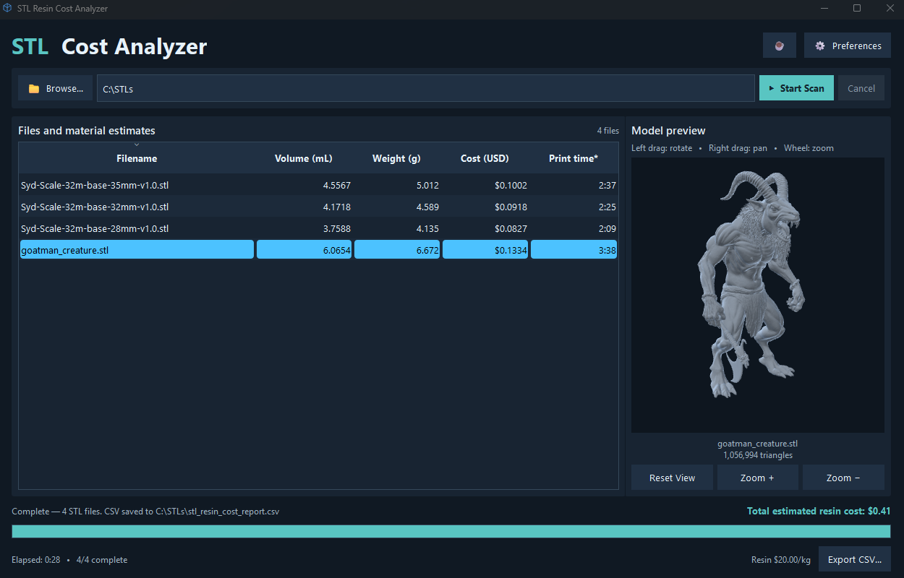
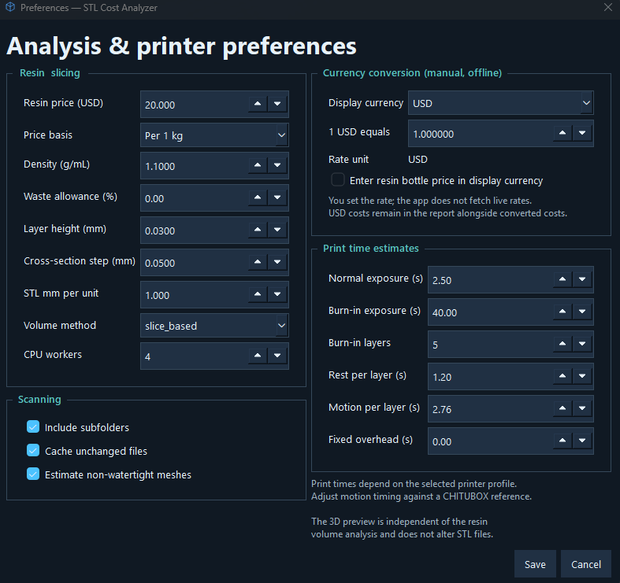
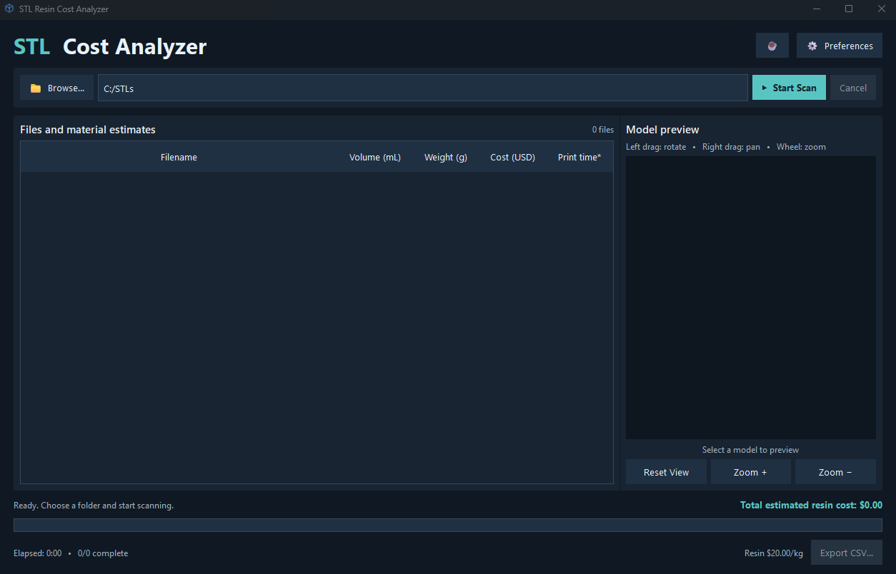

# STL Resin Cost Analyzer

**Free Windows software for estimating resin 3D-printing costs and approximate print times from STL files.**

[**Download the latest Windows release**](https://github.com/KEslinger78/STL-Resin-Cost-Analyzer/releases/latest)

STL Resin Cost Analyzer scans folders of models and helps you estimate resin consumption without opening each STL in a slicer.

## Features

- Batch scan folders of `.stl` files, optionally including subfolders.
- Estimate resin volume (mL), weight (g), material cost, and approximate printing time.
- Configurable resin cost, density, waste factor, slice settings, and printer time profile.
- Interactive OpenGL preview: rotate, zoom, and pan.
- Caching and parallel processing for collections of models.
- Display costs in several currencies using **manual exchange rates** (USD by default).
- Export results to an Excel-compatible CSV file.
- Optional developer tips; all functions are free.

## Screenshots

### Completed analysis and interactive 3D preview

### Printer, resin, and currency preferences

### Main application window

## Install

1. Visit [the latest release](https://github.com/KEslinger78/STL-Resin-Cost-Analyzer/releases/latest).
2. Download `STL-Resin-Cost-Analyzer-v1.0.1-win64.exe`.
3. Save the EXE to any folder and run it. There is **no ZIP to extract**, installer to run, or Python requirement.
4. Select your STL folder, configure Preferences, and click **Start Scan**.

**Windows SmartScreen:** This independent freeware currently uses an **unsigned** executable, so Windows may show an "Unknown Publisher" notice. Obtain the program only from this official GitHub release. A matching `SHA256SUMS.txt` is provided for download verification.
## Accuracy and limits

The tool estimates resin usage from model geometry. It is not a slicer and cannot predict all effects of printer settings or supports added later. Hollowed, damaged, self-intersecting, or complex meshes may give different results from CHITUBOX or Lychee. Print duration is an estimate rather than a guaranteed completion time.

**Verify important prints in your slicing application.**

## Privacy and help

Models are analyzed locally; STL files are not intentionally uploaded. Exchange rates are stored/entered locally and are not automatically fetched. No application telemetry is built in. The optional tip link opens an external Venmo page. See [Privacy](PRIVACY.md) and [Support](SUPPORT.md).

Please report bugs or suggestions through [GitHub Issues](https://github.com/KEslinger78/STL-Resin-Cost-Analyzer/issues). Do not upload third-party or private models without permission.

## License

**Freeware; source code is private.** Third-party license notices are provided as a separate release asset (`THIRD_PARTY_LICENSES-v1.0.1.zip`) and are also embedded in the EXE. LGPL rights are unaffected by the application freeware terms. The program is independently maintained by **KEslinger78**, not associated with 10th Circle.
